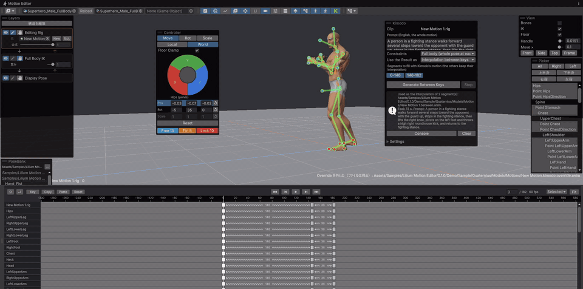

# Lilium Motion Editor (Experimental)

[English](README.md) | 日本語

Unity エディタの中でキャラクターのモーションを作るためのエディタ拡張です。



+ キャラクターの骨を複製した「編集用リグ」を通してポーズを付け、リグの値をアニメーションクリップへ保存します。
+ フルボディ IK でポーズを編集できます。
+ 体型の違うキャラクターでも、同じ編集用リグのクリップを使い回せます。
+ 保存すると、ゲーム用の Humanoid クリップを焼きます。Animation Rigging の値やほかのプロパティも入ります。
+ キーの間の補間を曲線・直線・ステップ・AI から選べます。ループ用のサイクルキーもあります。
+ AI を使って、Unity CLI からもポーズ・モーションを作れます。
+ オプションで、NVIDIA のモーション生成モデル Kimodo を使い、打ったキーの間の動きを文章から作れます。
+ 非破壊でゲーム中の最終的なポーズを確認しながらモーションを作成できます。
+ DCC ツールを行き来する必要はありません。編集するとすぐにモーションが反映されます。
+ 開発中です。将来のバージョンで仕様が変わります。

## Dependencies

+ Unity 6000.0 以降（6000.6 以降では、プレビュー窓の骨ハンドルが Unity のツールの仕組みに乗り、Tools オーバーレイから道具を選べます）
+ Burst / Mathematics（パッケージの依存として自動で入ります）
+ Animation Rigging（任意。入っていると Animation Rigging の値を編集できます）
+ Timeline（任意。入っていると Timeline のクリップを編集できます）

## Install

Package Manager の `Install package from git URL...` に次を入力します。

```
https://github.com/you-ri/LiliumMotionEditor.git?path=/Packages/jp.lilium.motioneditor
```

## How to use

1. `Window > Lilium Motion Editor > Motion Editor` を開きます。
2. Animator の付いたキャラクターの prefab を選びます。
3. ポーズを付けてキーを打ち、クリップへ保存します。

+ プロジェクト全体の設定は `Project Settings > Lilium Motion Editor` にあります。
+ 編集用リグの定義は `Create > Lilium Motion Editor > Rig Definition` で作れます。
+ 画面の言語（English / 日本語）は `Preferences > Lilium Motion Editor` の Language で選べます。既定は OS の言語に合わせます。

### Demo

Package Manager でこのパッケージを選び、Samples の `Demo` をインポートします。

デモのモデルは Quaternius の [Universal Base Characters](https://quaternius.com/packs/universalbasecharacters.html)（CC0）の男女 2 体です。

`Demo/Poses` には手の形の姿勢（Fist・Open・Point など 8 つ）が入っています。PoseBank に出すには、`Project Settings > Lilium Motion Editor` の PoseBank Folders に、`{prefabFolder}/Poses` と、インポートした `Demo/Poses` のフォルダ（例 `Assets/Samples/Lilium Motion Editor/<version>/Demo/Poses`）を足します。Humanoid の指の値なので、指の骨のある Humanoid のキャラクターならそのまま貼れます。

### Kimodo（オプション）

Samples の Kimodo (オプション) を使うと、NVIDIA のモーション生成モデル [Kimodo](https://github.com/nv-tlabs/kimodo) に、打ったキーの間の動きを文章から作らせ、
キーの姿勢を残したまま Override として取り込めます。Kimodo は同梱していませんが、セットアップをアシストする機能を用意しています。ライセンスを確かめたうえで、各自用意してください。モーションエディタは Kimodo が無くても動きます。

Kimodo を動かすのに必要なもの:

+ NVIDIA の GPU（RTX 20 シリーズ以降。ビデオメモリは約 1.5 GB 使います）
+ 空きメモリ約 16 GB（文章を読む部分を CPU で動かすため）
+ ディスク約 25 GB（Python の環境と重み。Docker で動かすときは約 50 GB）
+ Hugging Face のアカウントと、Llama 3（`meta-llama/Meta-Llama-3-8B-Instruct`）の利用許可
+ Windows 11・RTX 2070 で動くことを確かめています

## License

[MIT](LICENSE)

アイコンには Google の [Material Icons](https://github.com/google/material-design-icons)（Apache License 2.0）を、デモのモデルには Quaternius の Universal Base Characters（CC0）を使っています。詳しくはパッケージの `Third-Party Notices.txt` を見てください。
